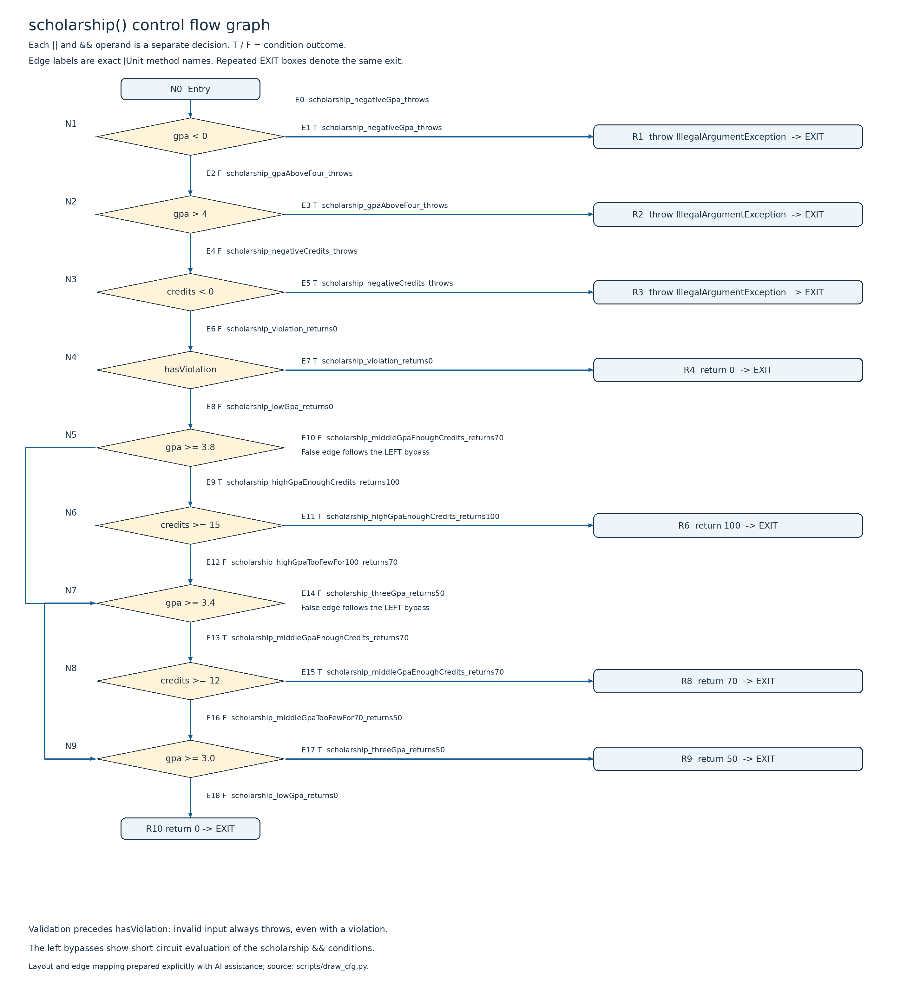

# Лаборатори 9 Код хамралт JaCoCo

Оюутны нэр: **Пүрэвдаш**  
Оюутны код: **B232270144**  
Хичээл: **F.CSA313 Программ хангамжийн чанарын баталгаа ба тест**

`java -version` командын бүтэн гаралт:

```text
openjdk version "21.0.12.1" 2026-08-18
OpenJDK Runtime Environment (build 21.0.12.1+1-1-deb13u1-Debian)
OpenJDK 64-Bit Server VM (build 21.0.12.1+1-1-deb13u1-Debian, mixed mode, sharing)
```

`mvn -version` командын бүтэн гаралт (ANSI өнгөний удирдлагын тэмдэглэгээг хассан):

```text
Apache Maven 3.9.9
Maven home: /usr/share/maven
Java version: 21.0.12.1, vendor: Debian, runtime: /usr/lib/jvm/java-21-openjdk-amd64
Default locale: en, platform encoding: UTF-8
OS name: "linux", version: "6.12.113+deb13-amd64", arch: "amd64", family: "unix"
```

Төсөл Java release 17, JUnit Jupiter 5.10.2, Maven Compiler Plugin 3.13.0,
Surefire 3.2.5, JaCoCo 0.8.12 ашиглана. JDK 21 дээр ажиллуулж шалгасан;
CI тохиргоонд Java 17 сонгосон. `mvn clean verify` нь тест, HTML/CSV тайлан,
90%-ийн branch coverage gate-ийг дараалан ажиллуулна.

## A Хэвийн урсгалын эхний хэмжилт

Эхний 5 тест: `letterGrade_highScore_returnsA`,
`letterGrade_middleScore_returnsC`, `gpa_twoGrades_returnsMean`,
`scholarship_highGpaEnoughCredits_returns100`,
`scholarship_middleGpaEnoughCredits_returns70`.

| Үе шат | Тест | Line covered / total | Line | Branch covered / total | Branch |
|---|---:|---:|---:|---:|---:|
| A | 5 | 16 / 25 | 64% | 22 / 41 | 53.66% |
| B | 20 | 25 / 25 | 100% | 41 / 41 | 100% |
| C | 22 | 25 / 25 | 100% | 41 / 41 | 100% |
| Эцсийн D | 29 | 25 / 25 | 100% | 41 / 41 | 100% |

Хувийг `COVERED / (MISSED + COVERED) * 100` томьёогоор тооцсон.
Нотолгоо: [A гаралт](results/mvn-verify-A.txt), [A CSV](results/jacoco-A.csv).
A үе шатанд оролт шалгах `if`-үүд болон `scholarship`-ийн `&&` нөхцөлүүдийн
алдаатай/кредит дутуу хувилбарууд дайрагдаагүй учир шар ромботой байна.
Онооны, хоосон массивын, буруу голч/кредитийн exception шидэх мөрүүд улаан;
мөн `D`, `F` буцаах болон тэтгэлгийн 50%, сүүлчийн 0% буцаах мөрүүдэд хүрээгүй.
`gpa`-ийн switch-д зөвхөн A, B орсон учир C, D, default/F салаанууд дутуу байв.

## B Бүтцийн хамралт ба CFG

A-ийн 5 тест дээр 15 тест нэмж, нийт **20 тестээр** Line болон Branch-ийг
100% болгосон. [B гаралт](results/mvn-verify-B.txt) дахь `Tests run: 20` болон
[B CSV](results/jacoco-B.csv) дахь `LINE_MISSED = 0`, `BRANCH_MISSED = 0`
нь энэ үр дүнг батална. Энэ үед starter-ийн `score > 60` алдааг засварлаагүй.



CFG-д N0 оролт, N1–N9 нөхцөл, R зангилаанууд return/throw болон гаралтыг
тэмдэглэнэ. E0–E18 ирмэгийн шошго дахь нэр бүр тест файл дахь бодит методын
нэртэй таарна; нэг ирмэгт түүнийг дайрах нэг төлөөлөх тестийг бичсэн.
`||`, `&&`-ийн операнд тус бүрийг тусдаа нөхцөл болгож, богино холболтыг
зүүн талын тойрох ирмэгүүдээр үзүүлсэн. Давтагдсан EXIT нь нэг гаралтын
зангилааг төлөөлнө. Зургийн байрлал, зангилаа, ирмэгийн холболтыг тодорхой
координатаар байгуулсан; дахин зурах эх нь [draw_cfg.py](scripts/draw_cfg.py).
Засварлах боломжтой diagrams.net эх: [cfg.drawio](cfg.drawio).
CFG-ийг AI тусламжтай цахим хэлбэрээр зурсан.

Оролтын `||`-ийн үнэн хувилбар бүрийг `scholarship_negativeGpa_throws`,
`scholarship_gpaAboveFour_throws`, `scholarship_negativeCredits_throws`
гэсэн тусдаа `assertThrows` тестээр шалгасан. 100%-ийн голч хангасан ч
кредит хүрэхгүй нөхцөлийг `scholarship_highGpaTooFewFor100_returns70`,
70%-ийн кредит дутууг `scholarship_middleGpaTooFewFor70_returns50` шалгана.
`gpa_allGradeCategories_returnsMean` нь A/B/C/D/F, тэр дундаа default/F
салааг дайрч, `(4+3+2+1+0)/5 = 2.0` гэдгийг батална.

## C Давталтын зааг

| Давталт | Тест | Хүлээх үр дүн |
|---|---|---|
| 0, хоосон массив | `gpa_emptyScores_throws` | `assertThrows(IllegalArgumentException.class, ...)` |
| null оролт | `gpa_nullScores_throws` | `assertThrows(IllegalArgumentException.class, ...)` |
| 1 | `gpa_singleGrade_returnsFour` | `[95]` → `4.0` |
| 2+ | `gpa_multipleGrades_returnsTwoPointFive` | `[95,85,75,65]` → `2.5` |

0 болон null тестүүд B хэсэгт аль хэдийн нэмэгдсэн; C хэсэгт 1 ба 2+
тохиолдлын хоёр тестийг нэмж, нийт **22 тест** болсон.
[Гаралт](results/mvn-verify-C.txt), [CSV](results/jacoco-C.csv).
Салааны хамралт нь давталтад орсон/гарсныг хэмждэг боловч яг нэг элемент болон
олон элемент дээр нийлбэр, хуваагч зөв ажиллаж байгааг батлахгүй.
Тиймээс хамралт өсөөгүй ч хоосон оролтын хамгаалалт, нэг элементийн үр дүн,
олон элементийн хуримтлал ба дундажийг тусгайлан шалгах шаардлагатай.

## D Зааг утгын алдаа ба засвар

B, C хэсэгт 100% хамралттай байсан эх код дээр дараах 7 тестийг нэмсэн:

| Метод | Оноо | Спецификацийн дүн |
|---|---:|---|
| `letterGrade_sixty_returnsD` | 60 | D |
| `letterGrade_justBelowSixty_returnsF` | 59.99 | F |
| `letterGrade_justBelowSeventy_returnsD` | 69.99 | D |
| `letterGrade_zero_returnsF` | 0 | F |
| `letterGrade_hundred_returnsA` | 100 | A |
| `letterGrade_justBelowNinety_returnsB` | 89.99 | B |
| `letterGrade_ninety_returnsA` | 90 | A |

`mvn test`-ийн [бодит уналтын гаралт](results/mvn-test-D-fail.txt):

```text
ScholarshipCalculatorTest.letterGrade_sixty_returnsD:81 expected: <D> but was: <F>
Tests run: 29, Failures: 1, Errors: 0, Skipped: 0
BUILD FAILURE
```

Алдаа: `if (score > 60) return "D";` нь 60 оноог F болгож байв.
Засвар: `if (score >= 60) return "D";`.
Зөвхөн энэ операторын засварыг агуулсан тусдаа commit: **5d4dde1** —
`Fix letterGrade: use >= 60 because the specification grades 60 as D`.
[Эцсийн гаралт](results/mvn-verify-final.txt) нь **29 тест, 0 failure, 0 error,
0 skipped, BUILD SUCCESS**; [эцсийн CSV](results/jacoco-final.csv) нь
`LINE_MISSED = 0`, `LINE_COVERED = 25`, `BRANCH_MISSED = 0`, `BRANCH_COVERED = 41`.

Салааны 100% хамралт нь шийдвэр бүрийн бүх үр дүн болон switch-ийн бүх салааг
ядаж нэг удаа дайрсныг харуулдаг. Гэвч тухайн салааг сонгох хязгаарын яг
ямар утгыг шалгасныг хэмждэггүй. `score > 60` болон `score >= 60` нь ижил
тооны салаатай тул 65 ба 50 оноо хоёуланг нь бүрэн хамруулж чадна.
Яг 60 онооны тест л хоёр операторын ялгааг илрүүлж, спецификацийн D дүнгийн
оронд F буцсаныг харуулсан. Иймээс хамралтыг oracle-д тулгуурласан зааг
утга, давталтын зааг, буруу оролтын тесттэй хослуулж байж зан төлөвийн
зөв байдлын нотолгоог сайжруулна.

## Нэмэлт даалгавар Coverage gate ба CI

`pom.xml` дэх `jacoco:check` нь `ScholarshipCalculator` классын Branch
хамралт 90%-иас доош үед `verify`-г унагана. A үеийн 5 тест ба эх кодыг
тусгаарласан хавтаст сэргээж, эцсийн gate-тэй POM-оор шалгахад тестүүд
бүгд амжилттай ч gate зориуд унасан:

```text
Rule violated for class mn.edu.must.sqat.ScholarshipCalculator: branches covered ratio is 0.53, but expected minimum is 0.90
BUILD FAILURE
```

Нотолгоо: [coverage gate уналт](results/mvn-verify-gate-fail.txt).
Эцсийн 100% хамралттай хувилбар дээр `All coverage checks have been met.`
гарч build амжилттай болсон. [.github/workflows/verify.yml](.github/workflows/verify.yml)
нь push, pull request, гар ажиллуулалтад Java 17 дээр `mvn clean verify`
болон үр дүнгийн тулгалтыг ажиллуулахаар тохируулсан.
GitHub-д байршуулаагүй тул hosted Actions run хараахан ажиллаагүй;
Maven gate-ийн хоёр хувилбарыг локал орчинд бодитоор шалгасан.

## Дахин ажиллуулах

Төслийн үндсэн хавтаснаас:

```bash
mvn clean verify
python3 scripts/verify_evidence.py
xdg-open target/site/jacoco/index.html
``` 

Шинэ хавтаст локал clone хийж шалгасан нотолгоо:
[clone-verify.txt](results/clone-verify.txt),
[clone-jacoco.csv](results/clone-jacoco.csv).

## AI туслахын хэрэглээ

Unit тестүүд бичих, A/B/C/D хэмжилтүүдийг Maven-аар ажиллуулахад ашиглагдсан. Гаралт, CSV нь бодит
ажиллуулалтаас хадгалагдсан.
